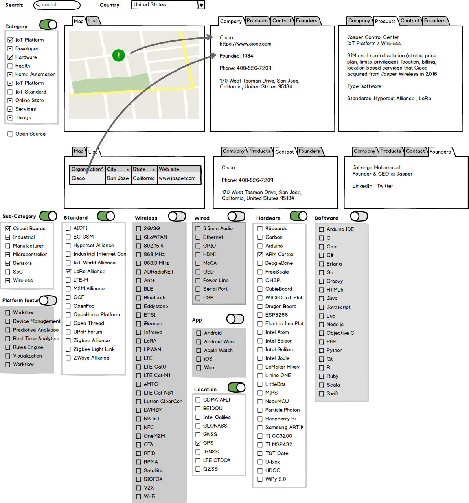

# iot_map

An interactive map of IoT organizations and products, built with Node.js, Express, MongoDB, EJS, and Google Maps.
This is an older project being maintained; many company and product links in the historical data may no longer work.

Select a category and subcategory to filter organizations and map markers.
Select an organization to see its details and products, or use the search field.
On mobile, Category and Sub-Category appear side by side when space permits and
stack on narrower screens. Either attached heading collapses or expands both
filter lists together; the Map button controls the map independently.
Company details stay in view without jumping to the
page top, with products below the company; Back restores your position in the results.
Desktop sections stay expanded, with products below the map.
Category and subcategory counts show distinct organizations, not products or map markers.
Each subcategory count is scoped to its parent category; organizations with multiple matching products count only once.
Type pills beneath organization names summarize the hardware, software, and services provided across all their products, with each type shown only once.
The navbar shows database-wide totals for organizations, people, and embedded product records, refreshed on page load and independent of the selected category.
Use the Light/Dark switch beside search to change the page and road-map theme.
The default is light; your choice is saved in this browser and restored on reload.
Satellite imagery retains its original appearance.

Organization social links use inline SVG paths vendored from Material UI in [social-icons.json](config/social-icons.json), with the [upstream license](config/social-icons.LICENSE).
No external icon font, CDN, or React runtime is needed for these icons.
Links retain accessible names and tooltips; legacy GooglePlus links use the Google icon, and unrecognized services retain text labels.
Empty social URLs are omitted.

## People and admin migration compatibility

`/people` lists people in pages of 50, with public detail pages at `/people/:slug`.
The list and the homepage people total include only people with a position linked to an IoT
organization (see below), so friends of IoT Map who only worked elsewhere are left out. Their
person pages still open from organization pages.
People without a slug remain readable in the list but are not given invented links.
Person pages display titles, websites, social profiles, and both legacy and migrated
positions. Legacy `company` and `date` remain readable: `date` is labeled **As of**,
never treated as a start/end date or evidence of current employment.

Social profile links come from the person's `<service>_url` fields (full profile URLs written by
iot_map_admin). For people not yet converted by `migrate-social-urls`, the older `<service>_id`
fields are still turned into links with each service's profile prefix.

Position organization links resolve the durable `organization_id` to the organization's
current slug. Stored position slugs and company-name guesses are not used for navigation.
Deleted organizations render as plain text, not broken links. Organization detail
responses (including search and standard lookup) include people whose positions reference
that organization ID, with links back to people that have slugs. Embedded founders support
both legacy `name` and new `first_name`/`last_name` values. After `migrate-founders`, a founder
links to their person page when exactly one person listed for the organization has the same
name (normalized for case and whitespace) and a position titled with "founder"; otherwise the
founder's stored URL, if any, is kept.

Organizations have an `iot_organization` flag. A missing flag counts as IoT, because every
organization added before the flag is an IoT organization. Organizations flagged `false`
(typically employers of friends of IoT Map) are excluded from the map, search, organization
lists, category counts and homepage totals. Their own page still opens from people's positions,
with a "Not listed on the IoT map" note. Queries use `mongoose.trusted` for the `$ne`, because
`sanitizeFilter` is on.

Comments are written in iot_map_admin and stored in the `comments` collection. This app reads
only comments with `public: true` and shows their text and date (never the author) on person
pages, organization pages and under each product. Private comments are never queried.
Direct organization visits render a full page; map AJAX requests retain their HTML fragments.

Birthday is excluded explicitly from every public person document query and by default
in the model. Public render data uses an allowlist, including nested positions, so unknown
fields and birthdays are not passed to templates. This is a read-only compatibility
change: it does not run migrations, create indexes, or update the database.

Deploy this public-app change **before** applying people/founder migrations from
`iot_map_admin`. Run `npm test`, verify person and organization pages against a backed-up
local copy containing old and new positions, deploy, and smoke-test the same routes on the
live service. A local passing test does not prove a production deployment has happened.
Only then approve production data migration, after taking and validating a backup.

## Setup

### Configuration

Create a `.env` file in the repository root:

```dotenv
GOOGLE_MAPS_API_KEY=your_google_maps_api_key
SHOW_PRODUCT_URLS=false
MONGODB_ENVIRONMENT=development
```

The public app is read-only and does not use login accounts, sessions, or cookies.
`SESSION_SECRET` is no longer needed and can be removed from existing deployments.

Keep `.env` out of version control.
Docker Compose reads it at runtime, and `.dockerignore` excludes it from the image build context.
Do not bake secrets into an image.

| Variable | Purpose | Default |
| --- | --- | --- |
| `GOOGLE_MAPS_API_KEY` | Browser key for the Google Maps JavaScript API | Required for the map |
| `NODE_ENV` | Express runtime environment | Docker image: `production`; Compose: `development`; set explicitly for other production deployments |
| `MONGODB_URI` | MongoDB connection URI, including the database name | Docker Compose: `mongodb://mongo:27017/iotmap`; required when running Node directly |
| `MONGODB_ENVIRONMENT` | Environment label shown in the UI; set it to match the MongoDB target | Compose: `development`; otherwise `unknown`; always hidden when `NODE_ENV=production` |
| `SHOW_PRODUCT_URLS` | Show product website URLs when set to exactly `true` | `false` |
| `PORT` | HTTP port used by Node | `3000`; Compose publishes it on host port `3030` |

The navbar shows the value of `MONGODB_ENVIRONMENT` so you can distinguish development
and production data. The Compose default is `development` for its local MongoDB; if
you override `MONGODB_URI`, also set this label to match. It is not inferred from the
URI. When `NODE_ENV=production` the label is hidden regardless of this setting.

### Run with Docker Compose

Install Docker with Compose, then run from the repository root:

```powershell
docker compose up -d --build
```

Open http://localhost:3030.
The local MongoDB service is available on port `27017`, with data persisted in the `mongodata` Docker volume.

To use Atlas instead of local MongoDB, add its connection URI as `MONGODB_URI` in `.env`.
Permit your IP in Atlas Network Access and give the public app's database user only the `read` role on `iotmap`.
The app does not write sessions or users, and automatic collection and index creation are disabled.
Manage data and indexes separately with administrative credentials; do not give those credentials to the public app.
Do not commit the URI or credentials.

After code or dependency changes, rebuild with `docker compose up -d --build iot_map`.
Compose loads `.env` at runtime.
After changing an environment value, restart the app with `docker compose up -d iot_map`; dependency or source changes need an image rebuild.

### Run without Docker

Install Node.js 20.19 or newer and provide `MONGODB_URI` in `.env`, pointing to local MongoDB or Atlas:

```dotenv
MONGODB_URI=mongodb://localhost:27017/iotmap
```

```powershell
npm install
npm start
```

Open http://localhost:3000.

### Render deployment

Deploy the Dockerfile on Render and set the environment variables above in the service settings.
Use Atlas for `MONGODB_URI`; the local Compose MongoDB hostname is not available on Render.
Render provides these variables at runtime; `.env` is not included in the image.
Allow the Render service's outbound IP ranges (shown in its dashboard) in Atlas Network Access, and confirm the database user has only the `read` role on `iotmap`.

The Docker image defaults to `NODE_ENV=production`. Explicitly set `NODE_ENV=production`
in Render's **Environment** settings as well, removing any development override.
After redeploying, use the Render shell to run `printenv NODE_ENV` and confirm it prints
`production`. The repository cannot confirm a live service's environment settings.
The public app no longer issues session cookies, so cookie security no longer depends on this setting.

The server waits for MongoDB before listening.
A failed connection logs `MongoDB startup failed` and exits instead of serving pages with buffered queries.
Check authentication, the URI's database name, and Atlas network access when diagnosing connection failures.

Automatic deploys require a pushed commit on the service's configured branch and auto-deploy enabled in Render.
Check build filters and any required CI checks if a push does not trigger a build.
Use **Manual Deploy > Deploy latest commit** to explicitly deploy the latest pushed revision.

## Data

The repository includes an organizations BSON dump in [dump/](dump/).
The people BSON file is in the external backup, not this repository; metadata files alone do not contain collection records.

See [setup notes](docs/setup.md) for restore and backup commands, including
the legacy first-name index that must be removed before importing people.
Check existing data before restoring: imports can partially succeed, and `--drop` replaces a collection.
Back up existing data before replacing it.
Treat people records and login-user backups as sensitive.

Public signup, login, logout, profile editing, the organization creation form,
and the `/users` and `/users/:username` routes are removed.
`/login`, `/logout`, and `/edit` return 404; there is no public write flow or request-body parser.
Passport, session storage, and their supporting dependencies are removed.
Existing `users` and `sessions` collections are not deleted or modified by this change.

A future, separate admin app must use its own database credentials and validate
website URLs on write, accepting only valid absolute `http:` or `https:` URLs
(including founder, post, stock, organization, product, and social links).
Do not rely on template URL normalization or CSP as write validation.

Run the public-app regression tests with `npm test`.

[IoT Thing of Things.xlsx](docs/IoT%20Thing%20of%20Things.xlsx) is a backlog of companies and products that had not yet been added to MongoDB.

## Product website URLs

Product website URLs are hidden by default because many are outdated.
To show them, set `SHOW_PRODUCT_URLS=true` in `.env` or the application's environment.
Only the exact value `true` enables them.
This does not hide organization website links or GitHub links.
Products without a name display "Unnamed product" while their website URLs are hidden.

Restart the app after changing this setting. With Docker Compose, run
`docker compose up -d iot_map` to apply an environment change.

## Google Maps configuration

Enable the Maps JavaScript API and billing for your Google Cloud project.
Configure the browser API key in [Google Cloud credentials](https://console.cloud.google.com/apis/credentials):

- Restrict the key to the Maps JavaScript API.
- Use **Websites (HTTP referrers)** as the application restriction, allowing `http://localhost:3030/*` for Docker, `http://localhost:3000/*` for direct Node, and your deployed site's URL as needed.

The key is sent to the browser by design; referrer and API restrictions limit where it can be used.

## Original mockup


